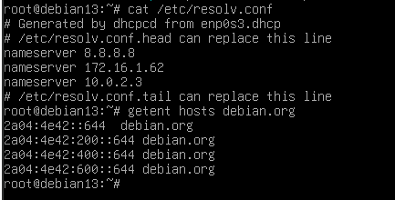

# Lab 01 — Network Configuration

## Tujuan

Memeriksa alamat IP, DNS, dan status interface pada Debian GNU/Linux 13, serta memahami bahwa hasil jaringan harus dibaca sesuai bukti yang nyata.

## Alat dan Bahan

- Mesin Debian GNU/Linux 13 dengan terminal.
- Perintah `ip`, `cat`, dan `getent`.
- Akses yang diizinkan untuk melihat konfigurasi jaringan lokal.

## Langkah Praktik

1. Periksa interface dan alamat IP:

```bash
ip -br addr
```

2. Periksa konfigurasi DNS dengan cara yang tersedia di sistem:

```bash
cat /etc/resolv.conf
```

Atau:

```bash
resolvectl status
```

3. Uji resolusi nama dengan perintah berikut:

```bash
getent hosts debian.org
```

4. Catat hasil dan bandingkan dengan bukti yang tersedia pada [catatan praktik](evidence/catatan-praktik.md).

## Fungsi Perintah

| Perintah | Fungsi |
|---|---|
| `ip -br addr` | Menampilkan ringkasan interface dan alamat IP aktif. |
| `cat /etc/resolv.conf` | Menampilkan konfigurasi resolver yang dipakai sistem saat ini. |
| `getent hosts` | Menguji resolusi nama menjadi alamat jaringan. |

## Bukti yang Terlihat pada Screenshot

Bukti yang tersedia menunjukkan:

- `ip -br addr` menampilkan `lo`, `enp0s3`, dan `enp0s8`.
- `enp0s3` memiliki alamat `10.0.2.15/24`.
- `enp0s8` memiliki alamat `172.16.1.62/24`.
- `/etc/resolv.conf` menampilkan nameserver `8.8.8.8`, `172.16.1.62`, dan `10.0.2.3`.
- `getent hosts debian.org` menghasilkan beberapa alamat IPv6.

Catatan penting: output `ip route` tidak terlihat pada screenshot yang tersedia, sehingga gateway default belum bisa dibuktikan dari bukti yang ada.

## Memahami IP, Gateway, dan DNS

- **IP** adalah alamat perangkat pada jaringan.
- **Gateway** adalah jalur keluarnya perangkat menuju jaringan lain.
- **DNS** adalah sistem yang menerjemahkan nama host menjadi alamat IP.

Ketiga komponen ini berbeda, tetapi saling berkaitan saat komunikasi jaringan berlangsung.

## Daftar Screenshot

Screenshot yang saat ini tersedia di folder `evidence/`:

- `01-network-interface.png` — interface dan alamat IP.
- `02-network-gateway-dns.png` — konfigurasi DNS dan uji resolusi nama.




## Kesimpulan

Berdasarkan screenshot yang tersedia, konfigurasi IP dan DNS dapat dibuktikan, tetapi gateway default belum terbukti karena `ip route` tidak ada dalam bukti. Sebelum mengubah konfigurasi jaringan permanen, perlu dipastikan terlebih dahulu bagaimana sistem jaringan pada mesin tersebut diatur.