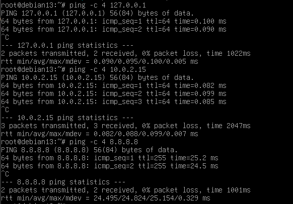
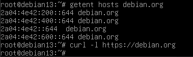

# Lab 02 — Connectivity Diagnostics

## Tujuan

Mengecek konektivitas secara bertahap agar dapat membedakan masalah interface, gateway, DNS, dan layanan aplikasi.

## Alat dan Bahan

- Mesin Debian GNU/Linux 13 dengan terminal.
- Perintah `ping`, `getent`, dan `curl` bila tersedia.
- Akses jaringan yang diizinkan untuk uji ke host lokal dan luar.

## Langkah Praktik

1. Periksa interface dan alamat IP:

```bash
ip -br addr
```

2. Uji koneksi ke alamat loopback dan alamat lokal:

```bash
ping -c 1 127.0.0.1
ping -c 1 10.0.2.15
```

3. Uji koneksi ke alamat luar yang diketahui, misalnya server DNS publik:

```bash
ping -c 1 8.8.8.8
```

4. Uji resolusi nama:

```bash
getent hosts debian.org
curl -I https://debian.org
```

5. Catat hasil setiap tahap pada [catatan praktik](evidence/catatan-praktik.md).

## Fungsi Perintah

| Perintah | Fungsi |
|---|---|
| `ping -c 1` | Menguji keterjangkauan host target. |
| `getent hosts` | Memeriksa resolusi nama sistem. |
| `curl -I` | Menguji respons HTTP/HTTPS terhadap host tujuan. |

## Bukti yang Terlihat pada Screenshot

Bukti yang tersedia menunjukkan:

- `ping` ke `127.0.0.1` berhasil.
- `ping` ke `10.0.2.15` berhasil.
- `ping` ke `8.8.8.8` berhasil.
- `getent hosts debian.org` menunjukkan beberapa alamat IPv6.
- `curl -I https://debian.org` terlihat dijalankan, tetapi hasil status HTTP tidak terbaca dengan jelas pada screenshot yang tersedia.

Informasi default gateway (`ip route`) tidak terlihat pada bukti, sehingga perlu disimpulkan bahwa gateway belum terbukti pada tahap ini.

## Kemungkinan Penyebab Gangguan

- Masalah interface: tidak ada alamat aktif atau jaringan tidak terhubung.
- Masalah route: tidak ada jalur keluar ke jaringan lain.
- Masalah DNS: nama tidak bisa diterjemahkan ke alamat IP.
- Masalah layanan: host bisa dijangkau secara IP, tetapi layanan di port tertentu tidak merespons.

## Daftar Screenshot

- `03-connectivity-test.png` — uji konektivitas ke loopback, IP lokal, dan 8.8.8.8.
- `04-connectivity-diagnostics.png` — uji DNS dan upaya akses layanan.





## Kesimpulan

Berdasarkan screenshot yang tersedia, konektivitas dasar menuju loopback, alamat lokal, dan DNS publik terlihat baik. Namun gateway default dan hasil akses layanan yang komprehensif belum terbukti sepenuhnya karena bukti `ip route` dan respons HTTP yang jelas belum tercantum secara lengkap.