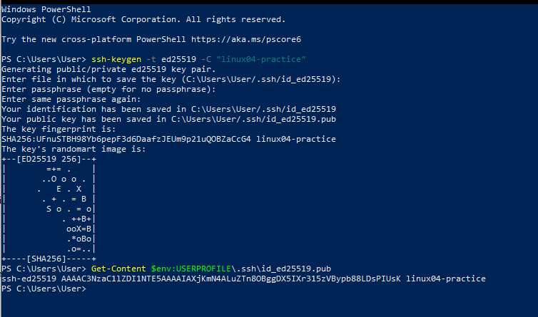
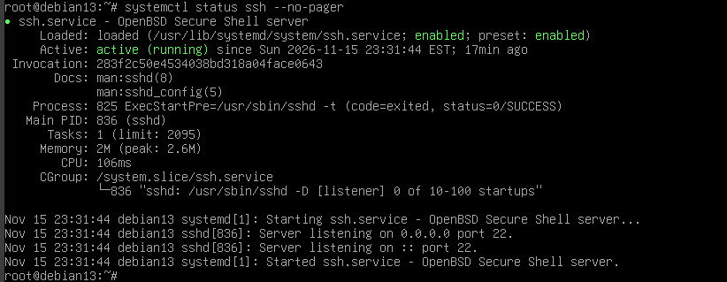

# Lab 03 — SSH Key Authentication

## Tujuan

Memeriksa layanan SSH pada Debian dan membuat pasangan kunci ed25519 untuk autentikasi yang aman. Praktik ini harus menampilkan bukti yang nyata, bukan asumsi.

## Alat dan Bahan

- Mesin Debian GNU/Linux 13 sebagai server.
- Komputer klien dengan PowerShell atau terminal Linux.
- Perintah `ssh-keygen`, `ssh`, dan `systemctl`.

## Langkah Praktik

1. Periksa layanan SSH di server:

```bash
systemctl status ssh --no-pager
```

2. Buat kunci ed25519 di klien:

```bash
ssh-keygen -t ed25519 -C "linux-practice"
```

3. Jalankan perintah untuk menyalin public key ke akun yang dituju, sesuai lingkungan nyata:

```bash
ssh-copy-id -i ~/.ssh/id_ed25519.pub <akun>@<host-server>
```

4. Uji login menggunakan private key dari klien di sesi terpisah.

## Fungsi Perintah

| Perintah | Fungsi |
|---|---|
| `systemctl status ssh --no-pager` | Memeriksa status layanan SSH. |
| `ssh-keygen -t ed25519` | Membuat pasangan kunci ed25519. |
| `ssh-copy-id` | Menempatkan public key pada akun server yang dituju. |
| `ssh -i` | Mencoba login menggunakan private key tertentu. |

## Bukti yang Terlihat pada Screenshot

Bukti yang tersedia menunjukkan:

- Layanan SSH aktif pada server (`Active: active (running)`).
- Kunci ed25519 dibuat dengan perintah `ssh-keygen` pada klien Windows PowerShell.
- Public key ditampilkan dalam bentuk `ssh-ed25519 AAAA...` dan fingerprint SHA256.
- Login menggunakan private key tidak terlihat pada file screenshot yang tersedia.

Untuk keamanan, private key tidak ditampilkan dan tidak disalin ke dokumentasi. Hasil ini hanya membuktikan pembuatan kunci dan status layanan, bukan keberhasilan login dengan kunci.

## Public Key dan Private Key

- **Private key** adalah bagian rahasia yang disimpan aman di komputer klien.
- **Public key** dapat dipasang pada server agar kunci tersebut dikenal.
- Private key tidak boleh dibagikan, disimpan di repo, atau ditampilkan pada screenshot.

## Daftar Screenshot

- `05-ssh-key-generation.png` — pembuatan kunci ed25519.
- `06-ssh-key-login.png` — status layanan SSH pada server.





## Kesimpulan

Dari screenshot yang tersedia, pembuatan pasangan kunci dan status server SSH dapat dibuktikan. Namun login SSH menggunakan private key belum terbukti dengan bukti yang jelas, jadi praktik ini belum dapat dinyatakan selesai tanpa sesi login yang terverfikasi.