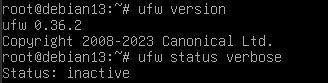
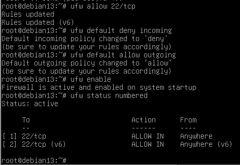

# Lab 04 — Firewall Configuration

## Tujuan

Memeriksa firewall yang tersedia dan menetapkan aturan yang diperlukan sesuai bukti yang ada, tanpa membuka seluruh port dan tanpa menutup akses administrasi secara tidak sengaja.

## Alat dan Bahan

- Mesin Debian GNU/Linux 13.
- Hak akses `sudo` untuk melihat status firewall dan mengubah aturan.
- Perintah `ufw` dan `systemctl` bila tersedia.

## Langkah Praktik

1. Periksa versi UFW dan status awal:

```bash
ufw version
ufw status verbose
```

2. Izinkan SSH jika diperlukan untuk akses jarak jauh:

```bash
ufw allow 22/tcp
```

3. Ubah kebijakan default agar hanya port yang diperlukan yang terbuka:

```bash
ufw default deny incoming
ufw default allow outgoing
```

4. Aktifkan firewall:

```bash
ufw enable
ufw status numbered
```

5. Catat hasil pada [catatan praktik](evidence/catatan-praktik.md).

## Fungsi Perintah

| Perintah | Fungsi |
|---|---|
| `ufw version` | Menampilkan versi UFW yang terpasang. |
| `ufw status verbose` | Menampilkan status firewall dan konfigurasi aktif. |
| `ufw allow 22/tcp` | Mengizinkan akses SSH pada port 22. |
| `ufw default deny incoming` | Menolak koneksi masuk baru, kecuali yang diizinkan. |
| `ufw default allow outgoing` | Mengizinkan koneksi keluar. |
| `ufw enable` | Mengaktifkan firewall pada sistem. |

## Bukti yang Terlihat pada Screenshot

Bukti yang tersedia menunjukkan:

- `ufw 0.36` aktif pada Debian.
- `ufw status verbose` menunjukkan status `inactive` sebelum perubahan.
- `ufw allow 22/tcp` berhasil diterapkan.
- `ufw default deny incoming` dan `ufw default allow outgoing` diterapkan.
- `ufw enable` menghasilkan status `Firewall is active and enabled on system startup`.
- `ufw status numbered` menampilkan aturan: `22/tcp ALLOW IN Anywhere`.

Catatan penting: tidak ada screenshot yang menampilkan uji konektivitas setelah firewall aktif, jadi verifikasi akses sesudah perubahan belum tersedia.

## Daftar Screenshot

- `07-firewall-rules.png` — status awal dan pengaturan aturan UFW.
- `08-firewall-verification.png` — hasil `ufw allow 22/tcp`, `ufw enable`, dan status numbered.





## Kesimpulan

Berdasarkan screenshot yang tersedia, firewall UFW diaktifkan dan port 22 diizinkan. Namun belum ada bukti uji konektivitas setelah aktivasi firewall, sehingga konfigurasi belum dapat dianggap selesai sepenuhnya.